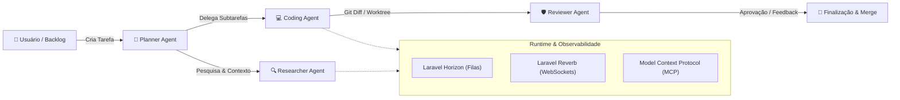

# 🤖 Agent Orchestrator

<p align="center">
  <strong>Plataforma visual e assíncrona para orquestração de múltiplos agentes autônomos de IA construída em Laravel e React.</strong>
</p>

<p align="center">
  <a href="https://github.com/Pedrohenr1qq/agent-orchestrator/actions"></a>
  <a href="https://github.com/Pedrohenr1qq/agent-orchestrator/blob/main/LICENSE"></a>
  <a href="https://php.net"></a>
  <a href="https://laravel.com"></a>
  <a href="https://react.dev"></a>
</p>

---

## 🌟 Visão Geral

O **Agent Orchestrator** é uma solução completa para orquestrar e coordenar equipes autônomas de inteligência artificial. Com suporte a streaming em tempo real, visualização de fluxos em tela infinita (canvas) e controle granular sobre ferramentas do sistema (arquivos, git, terminal e servidores MCP), o projeto permite planejar, codificar, revisar e executar tarefas complexas de ponta a ponta com supervisão humana.



---

## ✨ Principais Funcionalidades

- **🗺️ Canvas Interativo de Workflows**: Crie, edite e conecte nós de agentes em um canvas baseado em React Flow.
- **⚡ Streaming em Tempo Real**: Raciocínio (reasoning/thinking), chamadas de ferramentas e deltas de texto transmitidos instantaneamente para a interface via **Laravel Reverb** (WebSockets).
- **👥 Arquétipos de Agentes Especializados**:
  - `PlannerAgent`: Análise de requisitos, decomposição de épicos e delegação de tarefas.
  - `CodingAgent`: Escrita e modificação de código-fonte, manipulação de arquivos e refatoração.
  - `ResearcherAgent`: Leitura e indexação de documentos, navegação web e agregação de contexto.
  - `ReviewerAgent`: Análise de qualidade, inspeção de git diff e critérios de aceitação.
  - `SolidCraftCadAgent`: Integração com modelagem 3D e automação CAD.
  - `WriterAgent`: Produção de documentação técnica e relatórios.
- **🛠️ Ferramentas Nativas & Protocolo MCP**:
  - `ReadFileTool`, `WriteFileTool`, `EditFileTool`, `ListDirectoryTool`
  - `RunCommandTool` com restrição de diretório e controle de timeout
  - `GitStatusTool` e `GitDiffTool`
  - Conexão dinâmica com servidores **Model Context Protocol (MCP)** via stdio ou HTTP SSE
- **🌲 Isolamento por Git Worktree**: Cada tarefa de codificação pode operar em sua própria branch e diretório de trabalho dedicado, prevenindo conflitos na árvore principal.
- **🛡️ Review Gate & Human-in-the-Loop**: Visualização interativa de diffs com capacidade de aprovar ou rejeitar alterações antes do merge.

---

## 🛠️ Stack Tecnológica

| Camada | Tecnologias |
| :--- | :--- |
| **Backend** | PHP 8.4, Laravel 12, Laravel Ai SDK |
| **Filas & Jobs** | Laravel Horizon, Redis |
| **Comunicação em Tempo Real** | Laravel Reverb, Laravel Echo |
| **Frontend** | React 19, Inertia.js v3, TypeScript, Tailwind CSS, Lucide Icons |
| **Visualização** | `@xyflow/react` (React Flow) |
| **Banco de Dados** | PostgreSQL, SQLite (testes) |
| **Contêineres** | Laravel Sail (Docker Compose) |

---

## 🚀 Instalação e Execução

### Pré-requisitos
- [Docker](https://www.docker.com/) e Docker Compose instalados
- [Git](https://git-scm.com/)

### 1. Clonar o Repositório
```bash
git clone https://github.com/Pedrohenr1qq/agent-orchestrator.git
cd agent-orchestrator
```

### 2. Configurar o Ambiente
Copie o arquivo de exemplo de ambiente:
```bash
cp .env.example .env
```

### 3. Iniciar com Laravel Sail
Suba os contêineres de banco de dados, Redis e aplicação:
```bash
./vendor/bin/sail up -d
```

### 4. Instalar Dependências e Executar Migrações
```bash
./vendor/bin/sail composer install
./vendor/bin/sail artisan key:generate
./vendor/bin/sail artisan migrate
./vendor/bin/sail npm install
./vendor/bin/sail npm run build
```

### 5. Iniciar os Workers e WebSockets
Para habilitar o processamento em tempo real dos agentes:
```bash
# Iniciar o Horizon (Processamento de Jobs de IA)
./vendor/bin/sail artisan horizon

# Iniciar o Reverb (Servidor WebSocket)
./vendor/bin/sail artisan reverb:start
```

Acesse a interface em seu navegador: **`http://localhost`**

---

## 🧪 Testes e Qualidade

O projeto adota testes automatizados com [Pest PHP](https://pestphp.com/) e formatação rigorosa de código com [Laravel Pint](https://laravel.com/docs/pint).

```bash
# Executar a suíte de testes
./vendor/bin/sail artisan test --compact

# Formatar código PHP
./vendor/bin/sail pint

# Verificar tipos TypeScript e Lint frontend
npm run types:check
npm run check
```

---

## 🗺️ Roadmap de Evolução

- [x] Workspace interativo com React Flow e Kanban de tarefas
- [x] Streaming de eventos e reasoning via Reverb
- [x] Gerenciador de servidores MCP
- [ ] Execução sequencial de DAG baseada nas arestas do fluxo
- [ ] Modal interativo para aprovação de comandos sensíveis (Human-in-the-loop)
- [ ] Isolamento de execução de agentes em sandboxes Docker efêmeras
- [ ] RAG com PgVector para indexação semântica do código
- [ ] Dashboard de telemetria com contagem de tokens e custos em USD

---

## 🤝 Contribuição

Contribuições são muito bem-vindas! Consulte o arquivo [CONTRIBUTING.md](file:///home/pedro/dev/agent-orchestrator/CONTRIBUTING.md) para diretrizes sobre padrões de código, criação de novos agentes e fluxo de Pull Requests.

---

## 📄 Licença

Este projeto está licenciado sob a [Licença MIT](file:///home/pedro/dev/agent-orchestrator/LICENSE).
